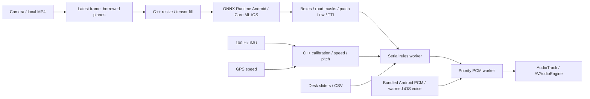

# Architecture comparison & tech stack recommendation

LearnDrive.AI Mobile uses **native Kotlin/CameraX on Android, Swift/AVFoundation on iOS, and a shared C++17 core**. This repository contains both mobile applications and an executable desktop test harness.

| Framework | Performance and latency | Memory | Maintainability |
| --- | --- | --- | --- |
| Kotlin + Swift + shared C++ (selected) | Direct access to camera plane pointers, sensor clocks and audio scheduling; no UI runtime in the frame loop | Avoids an additional Flutter engine or JS runtime; actual RSS must be measured | Two platform shells, one tested decision/fusion/vision core |
| Flutter + C++ FFI | Equally capable native loop when capture stays native; FFI alone does not make a camera plugin zero-copy | Additional engine/rendering footprint | Shared UI; platform capture, audio and lifecycle still require native code |
| React Native + JSI | JSI removes the asynchronous bridge; a fully native loop can be fast | Additional JS runtime/rendering footprint | Shared UI; native modules and lifecycle integration remain |

The memory preference above is an architectural inference, not a measured ranking. See [Flutter engine memory](https://docs.flutter.dev/add-to-app/performance) and [React Native JSI architecture](https://reactnative.dev/architecture/landing-page).

| Vision runtime | Performance / memory trade-off | Cross-platform trade-off |
| --- | --- | --- |
| ONNX Runtime Mobile (selected on Android) | Runs the bundled pretrained ONNX exports directly; CPU baseline uses two inference threads; reduced builds need model-specific operator lists | Good portability. NNAPI is deprecated on Android; Core ML provider support is graph dependent |
| LiteRT / TFLite | INT8 CPU and GPU delegates are alternatives to benchmark; quantized GPU execution uses a floating-point view | Requires separate verified exports and a runtime adapter |
| Native Core ML (selected on iOS), Qualcomm / MediaTek SDKs | Core ML offers direct platform integration and hardware selection; vendor Android SDKs can be fast on supported devices | Core ML needs separate exports. Qualcomm / MediaTek integrations add chipset, binary and licensing constraints |

Android uses ONNX Runtime 1.22.0 with bundled YOLOv8n COCO and TwinLiteNet pretrained weights exported at 320x320. Both use one reusable Float32 RGB NCHW tensor and CPU inference. iOS uses Core ML `.all` compute units and requires separate compatible exports. YOLOv10 and UFLDv2 have different output contracts and require dedicated decoders. **30+ FPS is a target for device benchmarking, not a supplied benchmark.**

Sources: [LiteRT Android versions](https://developers.google.com/edge/litert/android), [quantized GPU delegates](https://developers.google.com/edge/litert/performance/gpu), [ORT mobile provider guidance](https://onnxruntime.ai/docs/tutorials/mobile/), [NNAPI migration](https://developer.android.com/ndk/guides/neuralnetworks/migration-guide).

| Local speech | Startup / synthesis | Memory / clarity |
| --- | --- | --- |
| Piper | Entire phrase generation is model/device dependent; no universal 40 ms bound | Additional VITS weights and runtime; naturalness depends on voice; current upstream is GPLv3 |
| Sherpa-ONNX | Offline framework with multiple model families; benchmark time to first playable buffer | Additional models/runtime; broad voice support |
| Platform voices + PCM cache (selected) | Synthesize fixed phrases before starting; warning path only schedules cached PCM | Uses installed voice; no neural model in the frame loop; clarity must be checked on target phones |

No candidate establishes sub-40 ms **cold neural synthesis** from documentation alone. Cached PCM removes synthesis from the tactical latency budget. Android bundles 35 prerecorded PCM16 guidance/warning clips, rendered offline with the Windows Zira voice, so it needs no installed phone TTS voice. iOS warms installed platform speech into PCM buffers. Neither app downloads voices or models during a session. The Android manifest has no INTERNET permission. See [Android synthesis](https://developer.android.com/reference/android/speech/tts/TextToSpeech), [Apple speech buffers](https://developer.apple.com/documentation/avfaudio/avspeechsynthesizer/write(_:tobuffercallback:)), [Sherpa TTS](https://k2-fsa.github.io/sherpa/onnx/tts/index.html), [Piper upstream](https://github.com/OHF-Voice/piper1-gpl).

## Implementation and limits

Camera frames are borrowed while their OS owner remains alive. Native preprocessing writes a reusable tensor; YUV conversion/resizing and accelerator transfers are not literally zero-copy. No full-resolution frame crosses JNI as a byte array. Capture uses a single pending frame / latest-only policy. The shared core implements five-second stationary calibration, gyro/gravity pitch fusion, GPS/IMU Kalman speed estimation, sparse patch optical flow and box expansion TTI, segmentation decoding, class-aware NMS, and action suppression. Telemetry-based tactical rules keep a 3.5 s prompt gap; Android camera coaching can escalate urgency immediately. Audio plays on a separate worker with priority preemption.

Android opens in Camera mode and speaks a road-watching instruction when the camera binds and audio is ready. The first relevant person/vehicle detection triggers guidance without waiting for calibration, GPS, a multi-frame track or finite TTI. A large road user overlapping the center of the view triggers an obstacle caution even when the drivable mask is occluded or TTI is unknown. This uses image occupancy, not metric distance or a crash-recognition model. Routine camera guidance speaks once per scene and re-arms after two seconds of confirmed clear frames. Increasing urgency can trigger another warning immediately. Bend, slope and gear cues can interrupt image-only cautions; stronger collision cues retain priority. Low or unknown speed uses space/stop-preparation wording instead of routine slowing commands. Image-only cautions use gap wording at every speed. Its speech does not consume the tactical collision cooldown. Braking and phone shock suppress action cues; the startup instruction can still play. iOS basic hazard instructions retain the telemetry/TTI path; terrain guidance uses the shared event policy.

Camera detection caps inference at four frames per second and reduces the rate as the phone warms. Severe heat no longer silently stops inference; critical heat shows a pause message and resumes after cooling. Delayed detections show their capture age, with separate display-expiry and unchanged hazard-freshness limits. Camera/model errors and frame stalls remain visible. **Restart detection** reopens Camera and reloads both offline models.

**GPS is optional for speed-based advice.** For the user's camera-pointed-at-video test, Android's **Camera pointed at a road video (test)** setting defaults to ON. Set **Video / fallback driving speed** to the speed in that video; the phone's stationary GPS speed is ignored. **Use normalized phone slope** defaults to ON and retains measured calibration/motion state while using that video speed. Turn phone slope OFF to select an explicit simulated **Video slope**. Turn video test OFF for a mounted vehicle: fresh GPS/IMU speed then takes priority, including zero, and without a fix the saved manual fallback is used (initially 30 km/h). Enable **Require GPS speed** to require a fix for that path; basic camera guidance continues. Manual/video advice inputs never change measured fusion state. Physical tactical rules and slope cues require calibration and fresh motion data. Imminent-collision speech requires reliable expanding-object evidence; a large image alone produces a caution. **Test voice** checks playback independently. Desk mode's inputs are simulated. See [models/README.md](models/README.md) for source URLs, hashes, licenses and export contracts. Physical phone measurements, crash-video replay and road validation remain outstanding.

Bend, uphill/downhill and conditional manual-gear guidance all run in Android Camera mode. Bends use sustained road-mask curvature or paired lane markings without GPS or calibration; a yellow trace and Road status show the result. Tap **Normalize phone plane · level ground · hold still 5 s** with the rear camera forward in its fixed mount. The shared core captures a level coordinate frame and steady sensor offsets, then reports estimated relative inclination. Camera displays degrees and percent grade and uses sustained fresh pitch for slope cues. When filming a video, physical slope measures the phone's tilt; the simulated slope selector remains available with phone slope OFF. Each event speaks once; collision prompts take precedence. **Manual vehicle · gear guidance** adds conditional advice for obstacles, bends and slopes and defaults to ON unless an earlier preference is saved. Exact shift timing needs live gear/RPM, which this APK does not obtain from a vehicle; the Android Desk simulation exercises that shared policy. See [driving guidance and setup](docs/DRIVING_GUIDANCE.md). The iOS source also calls the shared terrain policy but has not been built on Windows.

Short slope cues use 2°, 5°, 8° and 12° bands after 1.5 seconds of sustained normalized pitch, with a 0.5-degree release margin. Steeper bands and direction changes can speak; already announced bands stay quiet until two seconds of level readings re-arm the event. Manual gearing is conditional. Maintain-speed wording requires low controlled speed plus a fresh straight-road fit and empty camera scene. Lost/unsupported slope readings are reported once. These bands are app settings awaiting vehicle validation, not official road categories.

Capture timestamps are preserved. Rules accept vision evidence younger than 350 ms and subtract capture age from estimated TTI; older or future-dated evidence is rejected. Approach tracking tolerates frame intervals below the same limit while still requiring matching textured expansion evidence. This accommodates the reported 179 ms processing time; it does not establish the target of <70 ms or 30 FPS.

A single stationary gravity vector cannot recover arbitrary yaw or road grade. Calibration assumes the rear camera faces forward, derives forward direction from the camera axis projected onto the horizontal plane, and rejects a near-vertical camera. Zero pitch is the calibration road: later pitch is relative to that baseline. IMU pitch measures the current mount/vehicle inclination, not a hill ahead. Monocular TTI is an expansion estimate with confidence gates, not metric ranging. Disable gear guidance for an automatic; appropriate manual gearing depends on the vehicle.

## Build and run

See [docs/BUILD.md](docs/BUILD.md) for Android, iOS and Windows/Linux desktop instructions; [docs/TESTING.md](docs/TESTING.md) for desk scenarios and latency acceptance criteria; and [docs/PROJECT_TREE.md](docs/PROJECT_TREE.md) for the complete source tree.

The core source is in `core/include/learndrive/` and `core/src/`; platform adapters are in `android/app/src/main/` and `ios/LearnDrive/`. The same core is used by the C++ desk harness, JNI and the Objective-C++ iOS bridge.
