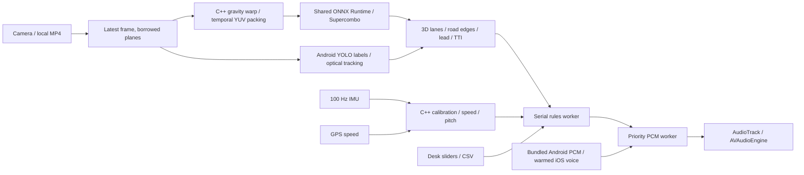

# LearnDrive.AI Mobile

**Current Android candidate: 0.5.0.** The Balanced Coaching Engine adds bounded
temporal context, encounter/maneuver history, independent evidence validation,
experimental routine pacing and persisted Minimal/Balanced/Guided settings.
Voice can be disabled while visual coaching and navigation continue. See the
[engine](docs/coaching/ENGINE.md) and
[implementation report](docs/coaching/IMPLEMENTATION_REPORT.md) for current checks
and limits. No trained reasoning model or instructor-qualified coaching accuracy
is claimed.

The charcoal dashboard integrates the map,
road camera, destination search and coaching voice. It supports both landscape
directions, keeps Start stable during readiness updates, and calibrates a level
reference automatically after confirming parked, level ground. Confirmed starts
wait for fresh camera evidence; cancelled requests cannot silently start later.

The preceding **0.4.8** candidate passed 19 stationary S24 Ultra / Android 16 checks and nine
bounded-start host cases. These are engineering checks, not paid learner-launch
or road qualification. Heat optimization remains deferred. See the
[Start repair review](docs/reviews/2026-10-22-start-control-repair.md),
[UI review](docs/reviews/2026-10-22-ui-redesign.md) and
[build instructions](docs/BUILD.md). APKs and local diagnostics are excluded from
Git; build the candidate locally as described in those instructions.

## Implementation history

The [unified driving-coach brief](docs/product/UNIFIED_DRIVING_COACH.md) now defines
the product target: map and live road camera together, destination search in the
same flow, measured driving status and one contextual coaching voice. It includes
the reference-video review, detailed build checkpoints and acceptance evidence.
Android 0.4.1 implements this dashboard foundation and passes the five functional
integration checks on the S24 Ultra. It is a development candidate; learner-release
qualification remains open. Android **0.4.2** adds the embedded Google provider:
both APKs assemble, 10/10 native groups pass, and six S24 smoke cases pass,
including real Places predictions and selected-place resolution. Full Navigation
route/feed/lifecycle checks and sustained thermal qualification remain open.
See the [Google increment review](docs/reviews/2026-10-19-google-navigation.md) and
[measured heat investigation](docs/reviews/2026-10-20-thermal-quickcheck.md).
Current Google candidate: `build/LearnDrive-0.4.2-debug.apk`.
Prior diagnostic build: **0.4.3**, `build/LearnDrive-0.4.3-debug.apk`.
Its Google display on/off/on capture shows substantial CPU load with the display
suspended, but thermal/throughput/Battery Saver changes prevent causal map-cost
attribution. No thermal fix is claimed. See the
[isolation results](docs/reviews/2026-10-20-map-rendering-thermal-check.md).
Prior foundation artifacts: `build/LearnDrive-0.4.1-debug.apk`
and `build/LearnDrive-Kerala-20261019-v3.ldnav` (about 319 MiB). See the
[implementation and verification review](docs/reviews/2026-10-19-unified-coach.md).

The [master action plan](docs/MASTER_ACTION_PLAN.md) sequences mount readiness,
recorded evidence, perception quality, calm speech, device profiling and post-drive
learning. Its first Android implementation slice is documented in
[automatic horizon readiness](docs/MOUNT_READINESS.md); see
[the execution record](docs/EXECUTION.md) for verification and remaining work.
The prior verified navigation artifact is `build/LearnDrive-0.4.0-debug.apk`, with
[Kerala offline navigation](docs/OFFLINE_NAVIGATION.md) and the separate
`build/LearnDrive-Kerala-20261019.ldnav` map/routing pack (about 291 MiB), plus
[parked setup and explicit level references](docs/SETUP_FLOW.md) and
[opt-in local diagnostic export](docs/SESSION_EVIDENCE.md) and
[learner camera coaching fixes](docs/reviews/2026-10-17-learner-coaching-fixes.md).
Samsung S24 Ultra running Android 16 is the first physical qualification target.
The user reports the stationary setup checklist worked; a first camera diagnostic
export passed structural inspection. The 0.4.0 offline routing/map instrumentation
passed on that phone; see [the measured results](docs/reviews/2026-10-19-offline-navigation.md).
Active-session, sustained-device, instructor/learner and road acceptance remain open.

The supplied Kochi/Munnar clip exposed false collision alerts in 0.3.0. The
corrected 0.3.1 build adds optical/detection corroboration and fixes emergency
speech restarts. See [the video review](docs/KOCHI_VIDEO_REVIEW.md) for the
before/after replay, annotated video, remaining missed cues and accuracy limits.

The [reliability roadmap](docs/RELIABILITY_ROADMAP.md) defines the proposed path
to an Android release for car learners in India, with measured accuracy,
physical-device qualification and instructor/learner pilot gates.

The first roadmap increment is available as `build/LearnDrive-0.3.2-debug.apk`.
Android Camera/MP4 and desktop replay now share native guidance selection and
source guards. MP4 no longer borrows live phone motion; recordings and screen
tests without original calibration use semantic detections only. Experimental
emergency phrases default off. See [the execution record](docs/EXECUTION.md) for
checks/remaining work and [the pipeline/phone checks](docs/GUIDANCE_PIPELINE.md).

LearnDrive.AI Mobile uses **native Kotlin/CameraX on Android, Swift/AVFoundation on iOS, and a shared C++17 core**. This repository contains both mobile applications and an executable desktop test harness.

The active spatial backbone is the bundled Comma.ai **Supercombo v0.8.13 ONNX model**, with shared native ONNX Runtime inference, gravity-based frame warping, temporal/recurrent state, 3D lane/road/path decoding and metric lead estimates. Android retains YOLO for road-user class labels; TwinLiteNet is a legacy asset. iOS uses the same ORT runtime through Objective-C++. See [the integration and acceptance record](docs/INTEGRATION.md) for the complete requirement audit, pinned model hash, verification commands and physical-device work still outstanding.

The Android app activates the [native dual-brain engine](docs/DUAL_BRAIN.md): a 100 Hz emergency reflex plus a deterministic 10 Hz contextual policy and speech arbitration. The tactical path is fully offline, bounded and does not require language-model weights. An optional asynchronous ONNX language-model worker remains available for post-drive experiments, but generated text is not the driving authority.

| Framework | Performance and latency | Memory | Maintainability |
| --- | --- | --- | --- |
| Kotlin + Swift + shared C++ (selected) | Direct access to camera plane pointers, sensor clocks and audio scheduling; no UI runtime in the frame loop | Avoids an additional Flutter engine or JS runtime; actual RSS must be measured | Two platform shells, one tested decision/fusion/vision core |
| Flutter + C++ FFI | Equally capable native loop when capture stays native; FFI alone does not make a camera plugin zero-copy | Additional engine/rendering footprint | Shared UI; platform capture, audio and lifecycle still require native code |
| React Native + JSI | JSI removes the asynchronous bridge; a fully native loop can be fast | Additional JS runtime/rendering footprint | Shared UI; native modules and lifecycle integration remain |

The memory preference above is an architectural inference, not a measured ranking. See [Flutter engine memory](https://docs.flutter.dev/add-to-app/performance) and [React Native JSI architecture](https://reactnative.dev/architecture/landing-page).

| Vision runtime | Performance / memory trade-off | Cross-platform trade-off |
| --- | --- | --- |
| ONNX Runtime Mobile (selected on Android and iOS) | Runs the bundled pretrained ONNX exports directly; CPU baseline uses two inference threads; reduced builds need model-specific operator lists | Shared C++ model contract and decoder on both platforms |
| LiteRT / TFLite | INT8 CPU and GPU delegates are alternatives to benchmark; quantized GPU execution uses a floating-point view | Requires separate verified exports and a runtime adapter |
| Core ML, Qualcomm / MediaTek SDK alternatives | Separate platform/vendor implementations can be benchmarked | Current iOS uses the shared native ORT/XNNPACK implementation |

Android and iOS use ONNX Runtime 1.22.0 for the pinned Supercombo model. XNNPACK is selected explicitly with two worker threads and optimized CPU fallback. QNN HTP is enabled only when a provisioned backend passes initialization, numeric comparison and measured latency gates. **30+ FPS and 30-minute thermal stability remain physical-device acceptance criteria.**

Sources: [LiteRT Android versions](https://developers.google.com/edge/litert/android), [quantized GPU delegates](https://developers.google.com/edge/litert/performance/gpu), [ORT mobile provider guidance](https://onnxruntime.ai/docs/tutorials/mobile/), [NNAPI migration](https://developer.android.com/ndk/guides/neuralnetworks/migration-guide).

| Local speech | Startup / synthesis | Memory / clarity |
| --- | --- | --- |
| Piper | Entire phrase generation is model/device dependent; no universal 40 ms bound | Additional VITS weights and runtime; naturalness depends on voice; current upstream is GPLv3 |
| Sherpa-ONNX | Offline framework with multiple model families; benchmark time to first playable buffer | Additional models/runtime; broad voice support |
| Platform voices + PCM cache (selected) | Synthesize fixed phrases before starting; warning path only schedules cached PCM | Uses installed voice; no neural model in the frame loop; clarity must be checked on target phones |

No candidate establishes sub-40 ms **cold neural synthesis** from documentation alone. Cached PCM removes synthesis from the tactical latency budget. Android bundles 51 cached PCM16 guidance/warning clips, so it needs no installed phone TTS voice. iOS warms installed platform speech into PCM buffers. Neither app downloads voices or models during a session. The Android manifest has no INTERNET permission. See [Android synthesis](https://developer.android.com/reference/android/speech/tts/TextToSpeech), [Apple speech buffers](https://developer.apple.com/documentation/avfaudio/avspeechsynthesizer/write(_:tobuffercallback:)), [Sherpa TTS](https://k2-fsa.github.io/sherpa/onnx/tts/index.html), [Piper upstream](https://github.com/OHF-Voice/piper1-gpl).

## Implementation and limits

Camera frames are borrowed while their OS owner remains alive. Native preprocessing writes a reusable tensor; YUV conversion/resizing and accelerator transfers are not literally zero-copy. No full-resolution frame crosses JNI as a byte array. Capture uses a single pending frame / latest-only policy. The shared core implements five-second stationary calibration, gyro/gravity pitch fusion, GPS/IMU Kalman speed estimation, sparse patch optical flow and box expansion TTI, segmentation decoding, class-aware NMS, and action suppression. Telemetry-based tactical rules keep a 3.5 s prompt gap; Android camera coaching can escalate urgency immediately. Audio plays on a separate worker with priority preemption.

Android opens in Camera mode with parked setup and road coaching paused. After a fresh camera result, voice readiness and explicit mount confirmation, Start begins the supervised session and permits startup speech. Lab settings are hidden during road sessions. Supercombo supplies spatial estimates; semantic detections also support cautious gap wording when metric TTI is unavailable. Routine camera guidance speaks once per scene and re-arms after two seconds of confirmed clear frames. Camera, terrain and tactical prompts share the native 3.5-second non-emergency cooldown and 10-second duplicate lock. Experimental emergency commands remain off by default; the research path supports immediate preemption and braking escalation. Phone shock suppresses action cues. iOS uses the shared deterministic policy and terrain rules but has not migrated to the new Android setup flow.

Camera ingestion targets 30 FPS, with latest-frame Supercombo analysis and Android semantic labels at 4 Hz. Analysis scheduling reduces to 25/20 Hz at light/moderate heat; severe heat reduces it further and critical heat pauses until cooling. These are scheduling limits, not measured inference throughput. Delayed detections show their capture age, with separate display-expiry and unchanged hazard-freshness limits. Camera/model errors and frame stalls remain visible. **Restart detection** reopens Camera and reloads the active offline models.

**GPS is optional for speed-based advice.** Android starts with the real road camera; select **Camera pointed at a road video (test)** explicitly in lab settings for screen tests each launch. In screen mode, set **Video / fallback driving speed** to the video's speed; stationary-phone GPS speed is ignored. **Use normalized phone slope** retains measured phone tilt while using that video speed; turn it OFF to select an explicit simulated **Video slope**. In mounted road mode, fresh GPS/IMU speed takes priority, including zero, and without a fix the labelled manual fallback is used (initially 30 km/h). Manual speed never proves the car has stopped. Enable **Require GPS speed** to require a fix for speed-based advice; basic camera guidance remains available after Start. Physical inclination lessons require a fresh, matching level reference explicitly confirmed while parked. Automatic normalization alone does not establish level ground. Imminent-collision research speech requires reliable expanding-object evidence; a large image alone produces a caution. **Check sound / Test voice** checks playback independently. Desk inputs are simulated. See [models/README.md](models/README.md) for model contracts and [the setup flow](docs/SETUP_FLOW.md) for current gates. Physical phone and road acceptance remain outstanding.

Bend and conditional manual-gear guidance run in Android Camera sessions. Bends use sustained curvature from projected Supercombo lane lines; a yellow trace and Road status show the result. To enable current-inclination lessons, choose **Set level reference (optional)**, explicitly confirm parked on level ground and hold the fixed forward-facing phone still for five seconds. Matching reference identity and motion freshness gate the displayed degrees/grade and slope cues; reference expiry cancels current audio, and reacquisition does not silently confirm level ground. The limited stopped-roll check can request a mount recheck but cannot detect every movement. When filming a video, physical slope describes the phone's tilt, not the recorded road. **Manual vehicle · gear guidance** supplies conditional advice; the APK does not obtain live vehicle gear/RPM. Phone-only gear estimation remains a planned experimental workstream. See [the current setup flow](docs/SETUP_FLOW.md) and [driving guidance](docs/DRIVING_GUIDANCE.md). The iOS source has not been built on Windows.

Short slope cues use 2°, 5°, 8° and 12° bands after 1.5 seconds of sustained normalized pitch, with a 0.5-degree release margin. Steeper bands and direction changes can speak; already announced bands stay quiet until two seconds of level readings re-arm the event. Manual gearing is conditional. Maintain-speed wording requires low controlled speed plus a fresh straight-road fit and empty camera scene. Lost/unsupported slope readings are reported once. These bands are app settings awaiting vehicle validation, not official road categories.

Capture timestamps are preserved. Rules accept vision evidence younger than 350 ms and subtract capture age from estimated TTI; older or future-dated evidence is rejected. Approach tracking tolerates frame intervals below the same limit while still requiring matching textured expansion evidence. This accommodates the reported 179 ms processing time; it does not establish the target of <70 ms or 30 FPS.

A single stationary gravity vector cannot recover arbitrary yaw or road grade. Calibration assumes the rear camera faces forward, derives forward direction from the camera axis projected onto the horizontal plane, and rejects a near-vertical camera. Zero pitch is the calibration road: later pitch is relative to that baseline. IMU pitch measures the current mount/vehicle inclination, not a hill ahead. Monocular TTI is an expansion estimate with confidence gates, not metric ranging. Disable gear guidance for an automatic; appropriate manual gearing depends on the vehicle.

## Build and run

See [docs/BUILD.md](docs/BUILD.md) for Android, iOS and Windows/Linux desktop instructions; [docs/TESTING.md](docs/TESTING.md) for desk scenarios and latency acceptance criteria; and [docs/PROJECT_TREE.md](docs/PROJECT_TREE.md) for the complete source tree.

The core source is in `core/include/learndrive/` and `core/src/`; platform adapters are in `android/app/src/main/` and `ios/LearnDrive/`. The same core is used by the C++ desk harness, JNI and the Objective-C++ iOS bridge.
