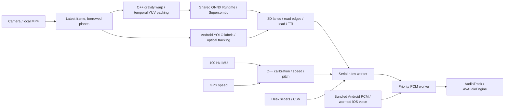

# LearnDrive.AI Mobile

**Current Android candidate: 0.8.6 (experimental, host-tested only).** A coach that speaks when
the learner has something to do, not about everything it sees
([what 0.8.6 changes](docs/coach/NOV12_FIXES.md)). On the Nov 12 drive 0.8.5 spoke 84 times in 14
minutes, 27 of them about traffic in the other lane, and said "Brake now" 11 times, mostly for
vehicles that were far away or being followed.

- **Distances are right with the phone leaning back.** At about 22 degrees of lean the horizon
  sits lower in the picture than the code allowed, and every distance came out two to five times
  too short.
- **"Brake now" only when hard braking is needed:** the right braking time, growth seen on two
  frames running, and never for a vehicle coming the other way.
- **Traffic coming the other way** is spoken about on a close pass; buses and trucks are still
  named early, but not one after another.
- **A budget:** at most three routine road-user sentences a minute, and shorter sentences. Turn
  instructions and emergencies are outside it.
- **Bends from Google's route:** which way and how sharp, with the speed and gear only when the
  learner is too fast for the bend.
- **The horizon and the speed reading** survive motion readings that arrive late.

Road users are still seen as far ahead as in 0.8.3–0.8.5, and people, riders and anything standing
in the path are still spoken about as early. Not yet tried on the phone.

**Previously, 0.8.5 (experimental, host-tested only).** The rest of what the Nov 8
drive showed ([what 0.8.5 fixes](docs/coach/NOV8_FIXES.md)), and a coach that says less as the
learner needs less ([you first](docs/coach/YOU_FIRST.md)).

- **The speed reading no longer freezes.** When the phone moved in its mount the motion processing
  stopped, the speed became a running average and dropped out for a second at a time. Speed, turn
  rate and camera pitch now carry on; only slope from the phone's tilt is lost.
- **Turn instructions are not cut off and said again.** A started sentence finishes through a gap
  in the speed reading; a step cut off after its key words is not started over; the same Google
  turn survives a camera restart and a route refresh. A real reroute is announced.
- **People at the road edge are not "Brake now".** The coach learns during the drive which way the
  car is heading in the image, so a phone turned towards the driver no longer puts the roadside in
  the path. A person in the lane no longer waits behind "Keep left" about someone else.
- **"Vehicle crossing. Brake now" only for vehicles that cross.** Not for a parked vehicle the
  tracker jumped to, a car overtaking and pulling in, or traffic coming round a left-hand bend.
- **One instruction per situation.** People standing together are told about once, "Brake now" is
  said once, a warning sentence is not cut at its last word when the vehicle has passed, and
  nothing is started about a pedestrian the car is already passing.
- **Names.** A scooter rider seen from behind is not a person; a pedestrian in front of a distant
  motorcycle is not a rider. (An autorickshaw can still be called a bus.)
- **Start.** With a Google route the hills come from the map, so the start dialog no longer asks
  for level ground.
- **Captions** stay on screen for turn, hill and gear instructions when camera frames run late.
- **You first.** The coach records what the learner's measured speed did about road users. Once
  the record shows they slow, it leaves out the slowing they have already done ("Oncoming bus. Keep
  left."), and later the whole instruction, shown on screen instead. A new learner is told
  everything in full, and "Brake now" is never left out.
- **The coach can now see slowing.** The measure behind every "is the learner slowing?" rule never
  reported "slowing" on stepped speed readings, so a learner who braked was still told "Brake now".

All 23 native test programs pass (16 older tests had been failing since 0.7.8). Not yet tried on
the phone.

**Previously, 0.8.4 (experimental, host-tested only).** Less phone heat, and camera
coaching no longer stops when the phone gets very hot ([phone heat](docs/coach/PHONE_HEAT.md)).

On the Nov 8 drive the phone was at Android's "moderate" heat 6 s in, and at "critical" from 15:11. From then on there was no camera coaching at all.

0.8.4 sheds work in order of value per watt:
- the costly distance model now runs only while the phone is cool;
- the lane model, which cost about 0.6 of a CPU core and held up road-user detection by ~0.3 s each run, is off;
- the camera drops to 15 frames a second once the phone is warm;
- the screen asks for 60 Hz;
- at "critical" the road-user detector keeps running at 5 a second ("Road users only · phone very hot") instead of stopping.

The evidence log now records the heat level on every frame. Not yet tried on the phone.

**Previously, 0.8.3 (experimental, host-tested only).** Road users are now seen,
and warned about, far enough ahead to act ([seeing road users in time](docs/coach/LONG_RANGE.md)).
On the Nov 8 drive, warnings came about 10 m out. There were two causes.
- Since 0.8.1 the road camera fills its panel, which crops the frames the coach reads. The coach still assumed the whole frame. With the phone pitched up, anyone more than ~13 m away appeared to stand above the horizon and was ignored. The coach now reads every box through the camera's real optics and crop.
- The camera gave the detector only 640×480. 0.8.3 asks for 1280×960. The single detector pass now sees the road at three scales: the whole road, a 2× view, and a 4× view of the far road at the camera's own resolution. The zoomed views are aimed along the road (Google's route line, else the turn rate).

A person is now boxed at about 55–70 m instead of ~28 m, and a bus at ~100 m.

Replayed on the Nov 8 drive:
- people standing in the lane are held steadily at ~41 m instead of ~9 m;
- the oncoming LEADER bus gets "Keep left" 3.6 s earlier than the phone gave it.

Seeing further exposed two "Brake now" rules tuned on near road users only:
- a crossing car anywhere within twice the stopping distance;
- a distant person's noisy flow-based collision time.

Both are tightened. Still too strong: "Brake now" for some people at the roadside. The likely cause is that the phone's camera is not aimed straight along the car (next fix, with phone heat). Not yet tried on the phone.

**Previously, 0.8.2 (experimental, host-tested only).** With a Google route, hills
now come from the map instead of the phone's tilt, which a sagging or fallen mount gets wrong
([hills from the map](docs/coach/MAP_HILLS.md)). The app reads the road's height along Google's
route from the Elevation API, in memory only. The coach names a climb or descent about 7 s before
it starts, with what to do at that speed: "Steep downhill ahead. Brake gently. Change down to
second." or "Uphill ahead. Change down to third. Steady accelerator." A ghat road's climb is named
once, not at every hairpin. Bridges, trees and buildings in the terrain model are not taken for
hills. This was tested on four Kerala roads with Google's own heights, and the app's exact request
was accepted by Google with the development key (the Elevation API is now enabled for it,
[setup](docs/GOOGLE_NAVIGATION_SETUP.md#6-hills-along-the-route-elevation-api)); it has not yet
been tried on the phone or the road. Without a Google route, the phone's tilt is used as before.
**Previously, 0.8.1 (experimental, host-tested only).** 0.8.1 was tested by
replaying the brain on the Nov 4, 5 and 6 drives ([drive replays](docs/coach/DRIVE_REPLAYS_081.md)).
Instructions are no longer cut off mid-word: braking is a sustained deceleration (phone vibration
read as braking cut speech all drive), a started sentence finishes, and a stop that is not urgent
ends at a natural pause. The coach speaks with the phone's own natural voice once every phrase is
rendered (built-in voice as fallback, switchable), joins phrases with natural pauses and never
clicks or crackles. Road-user warnings remove the car's own turning (bends made parked cars "cross"),
require a road user to stand on the road (a billboard said "Person crossing. Stop and wait"), keep
"Brake now" for a collision course, and call head-on traffic oncoming by its own approach speed.
Turn instructions come earlier at low speed, forks and merges get their own words, and "Straighten
the wheel" needs a turn actually made. In landscape the road camera now takes the right half of the
screen at full height (it fills its panel, trimming sky), with the map and the coach card on the left.
**Previously, 0.8.0 (experimental, host-tested only).** 0.8.0 lets the road-user
detector see about twice as far ahead at no extra cost: its image becomes a mosaic of the road
plus a 2x zoom of the far road, filling space letterboxing wasted, with every box mapped back to
true frame geometry so distances are unchanged ([detector mosaic](docs/coach/DETECTOR_MOSAIC.md)).
The risk coach acts on that earlier sight (about 6 s ahead instead of a fixed 25 m), ignores
"road users" that cannot be standing on the road and the phone mount at the frame edge, and an
urgent instruction now always says why ("Person ahead. Brake now."). Slope advice no longer
mistakes a sagging phone mount for a hill; the coach says when Google changes the route; the
coach card shows the next maneuver instead of filler text. 0.7.9 coaches every Google turn by
distance ("In 100 metres, turn right..."). 0.7.8 adds route-line bends and learned speed bumps.
**Previously, 0.7.7 (experimental, host-tested only).** 0.7.7 was tested by driving
the brain over real Kerala roads it had never seen, with and without a destination
([route-drive simulation](docs/coach/ROUTE_SIMULATION.md)). The map scout now follows roads that
bend where two map segments meet, treats a main road that bends away at a junction as a junction,
does not mistake a driveway for the road carrying on, and judges a junction the same from far
and near. Sharp bends are named about 7 s ahead, once, with no "change up" into them, and there
is no "move off" cue when the learner pulls up at the destination. 0.7.6 times junction
instructions by when the learner must act (about 10 s before a turn on a slow lane, more at speed)
and folds a due junction step into a road-user instruction instead of dropping it. 0.7.5 measures the
camera horizon so road-user distance and "brake now" urgency hold with a tilted phone, adds
Indian horn practice and map-based speed bumps and sharp bends, and shows the road-map state
(see the [instructor-labelled drive review](docs/reviews/2026-11-05-instructor-drive.md)). One situation planner
composes each instruction from everything relevant at that moment (hill, junction, the most
dangerous road users) instead of fixed sentences; junctions ahead are coached without a
destination from OpenStreetMap roads; lane keeping uses lane lines on marked roads; and an
opt-in instructor recording feeds the
[instructor benchmark](docs/coach/INSTRUCTOR_BENCHMARK.md). See the
[0.7.4 review](docs/reviews/2026-11-04-holistic-coach.md). A risk-reasoning coach
decides what to do about the most dangerous road user (crossing, oncoming, pedestrians) and
gives instructor-style control instructions; see the
[first real-drive review](docs/reviews/2026-11-04-real-drive-risk-coach.md). It schedules speech
around the known upcoming junction task (see
[task-aware scheduling](docs/reviews/2026-11-04-task-aware-scheduling.md) and the
[architecture review](docs/coach/ARCHITECTURE_REVIEW.md)). Automatic coaching coordinates
supported road-user, bend, hill and junction guidance throughout one supervised
session. No lesson selection is required. A destination adds junction preparation;
supported camera and terrain guidance can operate without a route. Speech tracks
delivery and current supporting evidence. Local records cover the whole drive.
See [automatic drive behavior and evidence](docs/coach/AUTOMATIC_DRIVE.md).
See the [complete coach specification](docs/coach/PRODUCT_SPECIFICATION.md),
[execution plan](docs/coach/EXECUTION_PLAN.md) and
[first lesson contract](docs/coach/JUNCTION_LESSON.md).
Full curriculum coverage and dependable human-coach teaching remain unqualified.

The native temporal coach
interprets encounter changes, uncertainty and actual cue delivery. Optional local
pretrained Qwen3/SmolLM2 inference runs in a separate shadow worker and has no
live speech authority. No model training is required. Model import and shadow
controls are under More options; normal coaching needs no language model.
See the [architecture](docs/intelligence/ARCHITECTURE.md),
[measured comparison](docs/intelligence/MODEL_BENCHMARK.md),
[Android setup](docs/intelligence/PRETRAINED_MODEL_INTEGRATION.md) and
[release gates](docs/intelligence/RELEASE_READINESS.md).
Model usefulness and Android model performance are not qualified for a paid launch.
Minimal/Balanced/Guided settings and the independent voice toggle are preserved.

The charcoal dashboard integrates the map,
road camera, destination search and coaching voice. It supports both landscape
directions, keeps Start stable during readiness updates, and calibrates a level
reference automatically after confirming parked, level ground. Confirmed starts
wait for fresh camera evidence; cancelled requests cannot silently start later.

The preceding **0.4.8** candidate passed 19 stationary S24 Ultra / Android 16 checks and nine
bounded-start host cases. These are engineering checks, not paid learner-launch
or road qualification. Heat optimization remains deferred. See the
[Start repair review](docs/reviews/2026-10-22-start-control-repair.md),
[UI review](docs/reviews/2026-10-22-ui-redesign.md) and
[build instructions](docs/BUILD.md). APKs and local diagnostics are excluded from
Git; build the candidate locally as described in those instructions.

## Implementation history

The [unified driving-coach brief](docs/product/UNIFIED_DRIVING_COACH.md) now defines
the product target: map and live road camera together, destination search in the
same flow, measured driving status and one contextual coaching voice. It includes
the reference-video review, detailed build checkpoints and acceptance evidence.
Android 0.4.1 implements this dashboard foundation and passes the five functional
integration checks on the S24 Ultra. It is a development candidate; learner-release
qualification remains open. Android **0.4.2** adds the embedded Google provider:
both APKs assemble, 10/10 native groups pass, and six S24 smoke cases pass,
including real Places predictions and selected-place resolution. Full Navigation
route/feed/lifecycle checks and sustained thermal qualification remain open.
See the [Google increment review](docs/reviews/2026-10-19-google-navigation.md) and
[measured heat investigation](docs/reviews/2026-10-20-thermal-quickcheck.md).
Current Google candidate: `build/LearnDrive-0.4.2-debug.apk`.
Prior diagnostic build: **0.4.3**, `build/LearnDrive-0.4.3-debug.apk`.
Its Google display on/off/on capture shows substantial CPU load with the display
suspended, but thermal/throughput/Battery Saver changes prevent causal map-cost
attribution. No thermal fix is claimed. See the
[isolation results](docs/reviews/2026-10-20-map-rendering-thermal-check.md).
Prior foundation artifacts: `build/LearnDrive-0.4.1-debug.apk`
and `build/LearnDrive-Kerala-20261019-v3.ldnav` (about 319 MiB). See the
[implementation and verification review](docs/reviews/2026-10-19-unified-coach.md).

The [master action plan](docs/MASTER_ACTION_PLAN.md) sequences mount readiness,
recorded evidence, perception quality, calm speech, device profiling and post-drive
learning. Its first Android implementation slice is documented in
[automatic horizon readiness](docs/MOUNT_READINESS.md); see
[the execution record](docs/EXECUTION.md) for verification and remaining work.
The prior verified navigation artifact is `build/LearnDrive-0.4.0-debug.apk`, with
[Kerala offline navigation](docs/OFFLINE_NAVIGATION.md) and the separate
`build/LearnDrive-Kerala-20261019.ldnav` map/routing pack (about 291 MiB), plus
[parked setup and explicit level references](docs/SETUP_FLOW.md) and
[opt-in local diagnostic export](docs/SESSION_EVIDENCE.md) and
[learner camera coaching fixes](docs/reviews/2026-10-17-learner-coaching-fixes.md).
Samsung S24 Ultra running Android 16 is the first physical qualification target.
The user reports the stationary setup checklist worked; a first camera diagnostic
export passed structural inspection. The 0.4.0 offline routing/map instrumentation
passed on that phone; see [the measured results](docs/reviews/2026-10-19-offline-navigation.md).
Active-session, sustained-device, instructor/learner and road acceptance remain open.

The supplied Kochi/Munnar clip exposed false collision alerts in 0.3.0. The
corrected 0.3.1 build adds optical/detection corroboration and fixes emergency
speech restarts. See [the video review](docs/KOCHI_VIDEO_REVIEW.md) for the
before/after replay, annotated video, remaining missed cues and accuracy limits.

The [reliability roadmap](docs/RELIABILITY_ROADMAP.md) defines the proposed path
to an Android release for car learners in India, with measured accuracy,
physical-device qualification and instructor/learner pilot gates.

The first roadmap increment is available as `build/LearnDrive-0.3.2-debug.apk`.
Android Camera/MP4 and desktop replay now share native guidance selection and
source guards. MP4 no longer borrows live phone motion; recordings and screen
tests without original calibration use semantic detections only. Experimental
emergency phrases default off. See [the execution record](docs/EXECUTION.md) for
checks/remaining work and [the pipeline/phone checks](docs/GUIDANCE_PIPELINE.md).

LearnDrive.AI Mobile uses **native Kotlin/CameraX on Android, Swift/AVFoundation on iOS, and a shared C++17 core**. This repository contains both mobile applications and an executable desktop test harness.

The active spatial backbone is the bundled Comma.ai **Supercombo v0.8.13 ONNX model**, with shared native ONNX Runtime inference, gravity-based frame warping, temporal/recurrent state, 3D lane/road/path decoding and metric lead estimates. Android retains YOLO for road-user class labels; TwinLiteNet is a legacy asset. iOS uses the same ORT runtime through Objective-C++. See [the integration and acceptance record](docs/INTEGRATION.md) for the complete requirement audit, pinned model hash, verification commands and physical-device work still outstanding.

The Android app activates the [native dual-brain engine](docs/DUAL_BRAIN.md): a 100 Hz emergency reflex plus a deterministic 10 Hz contextual policy and speech arbitration. The tactical path is fully offline, bounded and does not require language-model weights. An optional asynchronous ONNX language-model worker remains available for post-drive experiments, but generated text is not the driving authority.

| Framework | Performance and latency | Memory | Maintainability |
| --- | --- | --- | --- |
| Kotlin + Swift + shared C++ (selected) | Direct access to camera plane pointers, sensor clocks and audio scheduling; no UI runtime in the frame loop | Avoids an additional Flutter engine or JS runtime; actual RSS must be measured | Two platform shells, one tested decision/fusion/vision core |
| Flutter + C++ FFI | Equally capable native loop when capture stays native; FFI alone does not make a camera plugin zero-copy | Additional engine/rendering footprint | Shared UI; platform capture, audio and lifecycle still require native code |
| React Native + JSI | JSI removes the asynchronous bridge; a fully native loop can be fast | Additional JS runtime/rendering footprint | Shared UI; native modules and lifecycle integration remain |

The memory preference above is an architectural inference, not a measured ranking. See [Flutter engine memory](https://docs.flutter.dev/add-to-app/performance) and [React Native JSI architecture](https://reactnative.dev/architecture/landing-page).

| Vision runtime | Performance / memory trade-off | Cross-platform trade-off |
| --- | --- | --- |
| ONNX Runtime Mobile (selected on Android and iOS) | Runs the bundled pretrained ONNX exports directly; CPU baseline uses two inference threads; reduced builds need model-specific operator lists | Shared C++ model contract and decoder on both platforms |
| LiteRT / TFLite | INT8 CPU and GPU delegates are alternatives to benchmark; quantized GPU execution uses a floating-point view | Requires separate verified exports and a runtime adapter |
| Core ML, Qualcomm / MediaTek SDK alternatives | Separate platform/vendor implementations can be benchmarked | Current iOS uses the shared native ORT/XNNPACK implementation |

Android and iOS use ONNX Runtime 1.22.0 for the pinned Supercombo model. XNNPACK is selected explicitly with two worker threads and optimized CPU fallback. QNN HTP is enabled only when a provisioned backend passes initialization, numeric comparison and measured latency gates. **30+ FPS and 30-minute thermal stability remain physical-device acceptance criteria.**

Sources: [LiteRT Android versions](https://developers.google.com/edge/litert/android), [quantized GPU delegates](https://developers.google.com/edge/litert/performance/gpu), [ORT mobile provider guidance](https://onnxruntime.ai/docs/tutorials/mobile/), [NNAPI migration](https://developer.android.com/ndk/guides/neuralnetworks/migration-guide).

| Local speech | Startup / synthesis | Memory / clarity |
| --- | --- | --- |
| Piper | Entire phrase generation is model/device dependent; no universal 40 ms bound | Additional VITS weights and runtime; naturalness depends on voice; current upstream is GPLv3 |
| Sherpa-ONNX | Offline framework with multiple model families; benchmark time to first playable buffer | Additional models/runtime; broad voice support |
| Platform voices + PCM cache (selected) | Synthesize fixed phrases before starting; warning path only schedules cached PCM | Uses installed voice; no neural model in the frame loop; clarity must be checked on target phones |

No candidate establishes sub-40 ms **cold neural synthesis** from documentation alone. Cached PCM removes synthesis from the tactical latency budget. Android bundles 51 cached PCM16 guidance/warning clips, so it needs no installed phone TTS voice. iOS warms installed platform speech into PCM buffers. Neither app downloads voices or models during a session. The Android manifest has no INTERNET permission. See [Android synthesis](https://developer.android.com/reference/android/speech/tts/TextToSpeech), [Apple speech buffers](https://developer.apple.com/documentation/avfaudio/avspeechsynthesizer/write(_:tobuffercallback:)), [Sherpa TTS](https://k2-fsa.github.io/sherpa/onnx/tts/index.html), [Piper upstream](https://github.com/OHF-Voice/piper1-gpl).

## Implementation and limits

Camera frames are borrowed while their OS owner remains alive. Native preprocessing writes a reusable tensor; YUV conversion/resizing and accelerator transfers are not literally zero-copy. No full-resolution frame crosses JNI as a byte array. Capture uses a single pending frame / latest-only policy. The shared core implements five-second stationary calibration, gyro/gravity pitch fusion, GPS/IMU Kalman speed estimation, sparse patch optical flow and box expansion TTI, segmentation decoding, class-aware NMS, and action suppression. Telemetry-based tactical rules keep a 3.5 s prompt gap; Android camera coaching can escalate urgency immediately. Audio plays on a separate worker with priority preemption.

Android opens in Camera mode with parked setup and road coaching paused. After a fresh camera result, voice readiness and explicit mount confirmation, Start begins the supervised session and permits startup speech. Lab settings are hidden during road sessions. Supercombo supplies spatial estimates; semantic detections also support cautious gap wording when metric TTI is unavailable. Routine camera guidance speaks once per scene and re-arms after two seconds of confirmed clear frames. Camera, terrain and tactical prompts share the native 3.5-second non-emergency cooldown and 10-second duplicate lock. Experimental emergency commands remain off by default; the research path supports immediate preemption and braking escalation. Phone shock suppresses action cues. iOS uses the shared deterministic policy and terrain rules but has not migrated to the new Android setup flow.

Camera ingestion targets 30 FPS, with latest-frame Supercombo analysis and Android semantic labels at 4 Hz. Analysis scheduling reduces to 25/20 Hz at light/moderate heat; severe heat reduces it further and critical heat pauses until cooling. These are scheduling limits, not measured inference throughput. Delayed detections show their capture age, with separate display-expiry and unchanged hazard-freshness limits. Camera/model errors and frame stalls remain visible. **Restart detection** reopens Camera and reloads the active offline models.

**GPS is optional for speed-based advice.** Android starts with the real road camera; select **Camera pointed at a road video (test)** explicitly in lab settings for screen tests each launch. In screen mode, set **Video / fallback driving speed** to the video's speed; stationary-phone GPS speed is ignored. **Use normalized phone slope** retains measured phone tilt while using that video speed; turn it OFF to select an explicit simulated **Video slope**. In mounted road mode, fresh GPS/IMU speed takes priority, including zero, and without a fix the labelled manual fallback is used (initially 30 km/h). Manual speed never proves the car has stopped. Enable **Require GPS speed** to require a fix for speed-based advice; basic camera guidance remains available after Start. Physical inclination lessons require a fresh, matching level reference explicitly confirmed while parked. Automatic normalization alone does not establish level ground. Imminent-collision research speech requires reliable expanding-object evidence; a large image alone produces a caution. **Check sound / Test voice** checks playback independently. Desk inputs are simulated. See [models/README.md](models/README.md) for model contracts and [the setup flow](docs/SETUP_FLOW.md) for current gates. Physical phone and road acceptance remain outstanding.

Bend and conditional manual-gear guidance run in Android Camera sessions. Bends use sustained curvature from projected Supercombo lane lines; a yellow trace and Road status show the result. To enable current-inclination lessons, choose **Set level reference (optional)**, explicitly confirm parked on level ground and hold the fixed forward-facing phone still for five seconds. Matching reference identity and motion freshness gate the displayed degrees/grade and slope cues; reference expiry cancels current audio, and reacquisition does not silently confirm level ground. The limited stopped-roll check can request a mount recheck but cannot detect every movement. When filming a video, physical slope describes the phone's tilt, not the recorded road. **Manual vehicle · gear guidance** supplies conditional advice; the APK does not obtain live vehicle gear/RPM. Phone-only gear estimation remains a planned experimental workstream. See [the current setup flow](docs/SETUP_FLOW.md) and [driving guidance](docs/DRIVING_GUIDANCE.md). The iOS source has not been built on Windows.

Short slope cues use 2°, 5°, 8° and 12° bands after 1.5 seconds of sustained normalized pitch, with a 0.5-degree release margin. Steeper bands and direction changes can speak; already announced bands stay quiet until two seconds of level readings re-arm the event. Manual gearing is conditional. Maintain-speed wording requires low controlled speed plus a fresh straight-road fit and empty camera scene. Lost/unsupported slope readings are reported once. These bands are app settings awaiting vehicle validation, not official road categories.

Capture timestamps are preserved. Rules accept vision evidence younger than 350 ms and subtract capture age from estimated TTI; older or future-dated evidence is rejected. Approach tracking tolerates frame intervals below the same limit while still requiring matching textured expansion evidence. This accommodates the reported 179 ms processing time; it does not establish the target of <70 ms or 30 FPS.

A single stationary gravity vector cannot recover arbitrary yaw or road grade. Calibration assumes the rear camera faces forward, derives forward direction from the camera axis projected onto the horizontal plane, and rejects a near-vertical camera. Zero pitch is the calibration road: later pitch is relative to that baseline. IMU pitch measures the current mount/vehicle inclination, not a hill ahead. Monocular TTI is an expansion estimate with confidence gates, not metric ranging. Disable gear guidance for an automatic; appropriate manual gearing depends on the vehicle.

## Build and run

See [docs/BUILD.md](docs/BUILD.md) for Android, iOS and Windows/Linux desktop instructions; [docs/TESTING.md](docs/TESTING.md) for desk scenarios and latency acceptance criteria; and [docs/PROJECT_TREE.md](docs/PROJECT_TREE.md) for the complete source tree.

The core source is in `core/include/learndrive/` and `core/src/`; platform adapters are in `android/app/src/main/` and `ios/LearnDrive/`. The same core is used by the C++ desk harness, JNI and the Objective-C++ iOS bridge.
