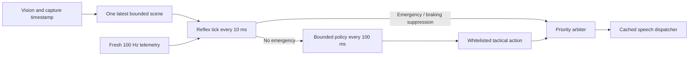

# Historical experimental ONNX decoder reference

This preserves the earlier decoder experiments and build recipes. References
below to language-model driving arbitration are obsolete: the current driving
coordinator never constructs or invokes a language model. See
[the current contract](DUAL_BRAIN.md) and [the integration audit](INTEGRATION.md).

The shared C++17 library contains a reflex evaluator, bounded scene serializer, deterministic contextual policy, optional asynchronous ONNX evaluator and priority arbiter. `desktop/dual_brain_harness.cpp` exercises the model-backed experimental pipeline. `ContextualPolicyEngine` is the production tactical authority used by Android.

**Integration status:** Android calls the native reflex at 100 Hz and evaluates the deterministic contextual policy every 100 ms. Accepted prompts use the existing audio worker, including emergency interruption, cooldown and deduplication. iOS still uses its existing policy. No SLM weights or tokenizer are bundled or required. Calibrated Camera2 intrinsics enable class-prior pinhole ranging for vehicles; unavailable intrinsics keep distance unknown.

## Runtime contract



- All timestamps use one monotonic clock in seconds. Android's serial rules worker calls the native decision function every 10 ms. Contextual evaluation is internally limited to once every 100 ms, and scene copies contain at most 64 objects.
- The reflex examines every object with finite confidence at least 0.65 and an active trajectory intersection. Vision expires at 350 ms; capture age is subtracted from TTI. A finite nonnegative TTI below 2.0 seconds, or a pedestrian at a calibrated distance of at most 5 meters, triggers level 1 `BRAKE_NOW`. Parallel traffic cannot trigger from TTI alone.
- Moderate or hard braking suppresses routine distance speech. A collapsing TTI below 1.2 seconds while braking emits `BRAKE_HARDER`, because the current braking effort may be insufficient. Fusion uses signed forward acceleration and requires a sensor sample younger than 150 ms. These are audio commands, not vehicle-control outputs.
- The production policy scans the bounded scene and emits only six cached tactical actions. It ignores sidewalk and parallel noise and resolves a pothole plus closing vehicle to `Hold lane and distance`. Reflex evaluation examines the full bounded scene.
- The optional model worker retains its bounded queue, cancellation, schema validation and 150 ms deadline for experiments. Its generated result does not control the Android production policy.
- Priority 1 belongs to the reflex. Allowed contextual phrases are `Hold lane and distance`, `Keep a safe gap`, `Slow down smoothly`, `Watch for pedestrians`, `Prepare for the bend`, and `Observe the road sign` (all 2–5 words). Sign advice needs an ego-lane association and measured distance within 40 meters; today's detector does not establish those fields.
- Only accepted speech commits the 3.5-second global non-emergency cooldown and 10-second per-phrase dedup. Signs and hazards share the phrase lock. Suppression holds off minor guidance for 3.5 seconds. Emergencies bypass both locks and flush current/queued speech; continuous emergencies repeat at most every 2 seconds, avoiding 100 sentence restarts per second.

The task's **1.2-second pothole is a reflex emergency** and cannot legitimately reach the contextual policy. Tests use a contextual variant: pothole TTI 2.4 seconds, bus TTI 3.8 seconds, decelerating bus, incline 8.5 degrees. The expected tactical action is `Hold lane and distance`. Numbered gears are unavailable without vehicle-specific RPM/gear evidence.

## ONNX model and providers

`OnnxLanguageModel.cpp` uses real `Ort::Env`, `Ort::SessionOptions`, `Ort::Session`, tensor construction and autoregressive `Session::Run` calls:

| Graph value | Contract |
| --- | --- |
| `input_ids`, `attention_mask` | int32/int64, batch 1, dynamic sequence |
| `position_ids` | Optional int32/int64; generated from past length |
| `past_key_values.N.key/value` | FP32/FP16 `[1, heads, past_length, head_dim]`, initially empty |
| `logits` | FP32/FP16 `[1, sequence, vocabulary]`; greedy final-position selection |
| `present.N.key/value` | Outputs moved into the next iteration with shape checks |

INT4 applies to weights/operators, not token IDs or KV storage. The ORT build must include the graph's quantized operators, including `MatMulNBits` where used; a vision-only reduced runtime is insufficient. Separate dynamic past/present buffers are required, not static shared-buffer/vendor-specific decoder contracts. The default budget allows at most 1 GiB of simultaneous past/present KV buffers, 512 input tokens and 96 output tokens. Weights, activations, logits and provider memory are additional. Over-budget prompts are rejected rather than truncated.

The matching `tokenizer.json` loads through [tokenizers-cpp](https://github.com/mlc-ai/tokenizers-cpp). Phi-3's role template and EOS IDs are defaults; ChatML, other EOS IDs and context limits are explicit C++ options. SmolLM needs its own configuration. Microsoft's [Phi-3 CPU INT4 configuration](https://huggingface.co/microsoft/Phi-3-mini-4k-instruct-onnx/blob/main/cpu_and_mobile/cpu-int4-rtn-block-32-acc-level-4/genai_config.json) documents the supported graph naming convention. The full model was not run here.

CPU is the default. CoreML registers explicitly with `AppendExecutionProvider("CoreML", ...)`, `MLProgram`, `MLComputeUnits=ALL`, dynamic shapes and an optional model-version-specific cache directory. Eligible partitions may use Apple hardware; registration does not prove INT4 execution on the Neural Engine. Unsupported operators retain CPU fallback. Provider initialization retries on CPU only with `allowCpuFallback`; the backend retains the reason. See [ORT CoreML configuration](https://onnxruntime.ai/docs/execution-providers/CoreML-ExecutionProvider.html).

**LiteRT is a separate runtime, not an ONNX Runtime provider.** It needs a separate backend/export. The optional Android provider here is NNAPI with its CPU device disabled; unsupported operators remain on ORT CPU. It is a legacy option, not the INT4 default. See [ORT providers](https://onnxruntime.ai/docs/execution-providers/) and [NNAPI configuration](https://onnxruntime.ai/docs/execution-providers/NNAPI-ExecutionProvider.html).

## Build and test

Default build, no new downloaded dependencies:

```sh
cmake -S . -B build/dual-brain -DCMAKE_BUILD_TYPE=Release
cmake --build build/dual-brain
ctest --test-dir build/dual-brain --output-on-failure
```

Portable Windows alternative:

```powershell
powershell -NoProfile -ExecutionPolicy Bypass -File tools/run_core_tests.ps1
```

Real ORT tests require Python `onnx`/`numpy` and a native SDK matching the host. Host verification used ORT **1.22.1**:

```sh
cmake -S . -B build/dual-brain-ort -DCMAKE_BUILD_TYPE=Release \
  -DLEARNDRIVE_WITH_ORT=ON -DONNXRUNTIME_ROOT=/path/to/onnxruntime-sdk
cmake --build build/dual-brain-ort
ctest --test-dir build/dual-brain-ort --output-on-failure
```

Put the runtime shared library on the loader path, or next to Windows executables. This portable Windows runner copies the DLL:

```powershell
powershell -NoProfile -ExecutionPolicy Bypass -File tools/run_onnx_decoder_tests.ps1 `
  -OrtSdkRoot .tools/onnxruntime-sdk/onnxruntime-win-x64-1.22.1
```

Tests generate a tiny synthetic causal decoder with FP32/FP16 variants and exercise real ORT prefill, KV steps, tensor inputs, greedy decoding, memory rejection, provider failure/fallback and cancelled output. This fixed-output graph does **not** measure SLM reasoning accuracy.

For a live Phi-3 harness, supply a pinned tokenizers-cpp checkout with submodules and Rust toolchain:

```sh
cmake -S . -B build/dual-brain-live -DCMAKE_BUILD_TYPE=Release \
  -DLEARNDRIVE_WITH_ORT=ON -DONNXRUNTIME_ROOT=/path/to/onnxruntime-sdk \
  -DLEARNDRIVE_WITH_HF_TOKENIZER=ON -DTOKENIZERS_CPP_SOURCE_DIR=/path/to/tokenizers-cpp
cmake --build build/dual-brain-live
build/dual-brain-live/dual_brain_harness /path/to/model.onnx /path/to/tokenizer.json
```

Keep external ONNX tensor data beside the model at its recorded paths. Nothing downloads at runtime. The live harness fails if loading, the expected action or the production deadline fails; it never substitutes the fixture. The tokenizer adapter and full SLM scenario need validation with the provisioned model.

## Mobile integration

The C callback context must outlive `ld_dual_destroy`. The clock callback must be thread-safe and use exactly the epoch of capture/telemetry timestamps; do not mix Android elapsed realtime with an unrelated C++ steady clock. Audio callbacks run only on the rules thread.

1. Android bundles `Brake now` and all six tactical phrases as PCM assets. JNI returns the selected prompt to the existing audio worker and commits cooldown/dedup only after playback is accepted.
2. Emergency submission cancels active and queued Android speech through `AudioTrack.pause/flush`; generation tokens prevent a cancelled callback from restarting it. iOS uses `AVAudioPlayerNode.stop` in its existing path.
3. Create the handle with local model/tokenizer paths and desired provider. Expose `ld_dual_status` / `ld_dual_error` to show startup or failure. A missing model leaves reflex available and produces no fabricated contextual guidance.
4. Under the existing platform native lock, call `ld_dual_read_vision` after successful `ld_vision`, attach telemetry and publish. A new unified detector can populate `ld_dual_scene` directly. Preserve capture time and explicitly set unknown distance/TTI to infinity; zero-initialized metric fields would imply measured zero.
5. Android calls `ld_dual_policy_decide` from its 10 ms rules worker. The native wrapper runs emergency evaluation each call and rate-limits contextual evaluation to 100 ms. Minor legacy coaching is retained only when the contextual result does not suppress it.
6. Reset on capture/mode/clock changes after stopping old producers. Before destruction stop producers/ticks, then join via `ld_dual_destroy` on a lifecycle thread. Model initialization and uninterruptible kernels can delay joining; do not destroy on camera/UI threads.

Android needs the optional CMake flags, native ORT headers/library for **each ABI**, and one compatible ORT `.so` aligned with the Java vision dependency (currently ORT 1.22.0). Avoid bundling incompatible duplicate runtimes. XcodeGen includes `core/src`; ORT/tokenizer bodies are compile-guarded. iOS needs the feature definitions, headers, ORT/CoreML/tokenizers libraries and their transitive dependencies for each architecture. Windows tests cannot validate Apple linkage.

100 Hz/10 Hz are scheduling targets. Host fixtures do not establish sub-1 ms worst-case phone/audio latency. Measure p50/p95/p99 reflex evaluation, audio start/stop, RSS, thermal throttling and camera frame rate with the actual model/phone.
