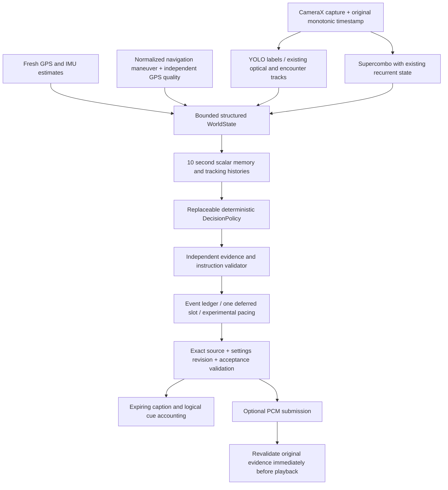

# Balanced Coaching Engine

This increment changes coaching decisions in the existing Android application. It retains CameraX, the semantic-first detector, the existing optical/encounter tracker, Supercombo recurrent inference, navigation providers and prerecorded PCM. It does not add a second camera pipeline or a generative voice service.

## Runtime boundary

Candidates are prevalidated before policy selection, then checked again at acceptance and playback onset. A policy can select only a bounded approved candidate; it cannot supply arbitrary speech or make a missing sensor available. The existing `ld_guidance_result` binary layout is unchanged. Calling `ld_coaching_configure` opts into this engine. Android does so explicitly; legacy C API clients and iOS retain their prior path until separately integrated and qualified.

## Compact temporal context

`TemporalSupport` synchronizes independent camera, telemetry and navigation capture clocks without re-dating an inference result. It records the existing track identities in distinct attention, optical and spatial namespaces. Tracking history retains bounded normalized positions at up to 4 Hz for ten seconds; current evidence still expires at 350 ms. A brief continuity gap is an uncertainty diagnostic, not a trajectory or proof that the road is clear.

`ShortMemory` stores up to 101 scalar scene snapshots, approximately ten seconds at 10 Hz, including fresh actors, speed/pitch/acceleration availability, road context and route context. `VehicleStateEstimator` needs contiguous valid speed samples before returning a trend; gaps, jumps and stale speed return unknown. Decreasing speed means only measured speed is falling. It does not identify brake-pedal position, gear, clutch or correct learner behavior. Prior accepted cues and event lifecycle live in a separate bounded ledger.

## Experimental decision and scheduling rules

- Default Balanced ordinary interval: 12 seconds. Minimal: 20 seconds. Guided: 8 seconds. These are starting values, not instructor-qualified safety thresholds.
- Same encounter/maneuver does not become new solely because it appears in another frame or changes distance wording. Escalation requires fresh supporting evidence.
- Independently validated urgent candidates bypass the ordinary interval. Android carries warning authority with the exact accepted ticket so a short pedestrian phrase can interrupt routine terrain speech even when its legacy phrase priority is lower.
- Routine unrelated coaching can defer near an imminent supported route turn. Measured decreasing speed can suppress redundant speed-only routine prompts. Unknown/stale motion does not claim driver response. Urgent warnings remain independently validated.
- At most one deferred routine candidate is retained. Every tick selects from current evidence again; it is not a FIFO that speaks old instructions later. Source, settings, relevance and capture expiry cancel pending work.
- No overlapping PCM streams. Optional voice off cancels audio but preserves caption/logical decisions, camera and navigation. Settings persist locally and invalidate older tickets through a monotonic revision.

Mechanical wording has explicit approved neutral fallbacks. Precise shifts require actual fresh vehicle-specific gear/RPM inputs, which ordinary phone operation does not have. A route turn cannot prove a selected gear, a sharp bend, road surface, or a lane-level vehicle position. Experimental critical commands remain disabled by default; a general object-size distance heuristic cannot qualify one.

## Delivery and concurrency

`NativeCore` owns the native monitor; model inference stays outside it. Delivery holds that monitor through audio submission and native logical acceptance. The PCM worker acquires the native monitor before the audio monitor when checking onset. Cancellation and nonblocking PCM writes share the audio monitor. Source changes and settings changes retire old work. No audio-monitor-to-native-monitor acquisition is permitted.

The accounting distinguishes eligible decision, logical acceptance, PCM submission and validated playback onset. None proves audibility or learner understanding. Parked review counts visual cues separately from voice submissions and does not assign learner faults.

## Capability and diagnostics

Standard uses the existing semantic and spatial models. Failure to load/run spatial inference, or three consecutive completed spatial stages at least 250 ms long, selects Basic semantic-only for that Vision instance. Explicit detector restart retries. This experimental budget leaves room within the unchanged evidence lifetime; it is not a phone-class certification or a thermal optimization claim. Known unsupported mount/pose assessment is preserved even in Basic. Advanced is explicitly unavailable; no policy model is installed automatically.

The existing performance snapshots add capability state, completed-stage counts and timing. Native diagnostics expose decision mode/block, event ID, evidence age, profile/revision, memory occupancy and delivery counters. Ordinary Google-backed retained traces omit provider-derived navigation fields; transient navigation context still supports live deterministic checks. Diagnostic capture remains opt-in and bounded. No new analytics, cloud inference, upload or paid service is introduced.

See [Android integration](android-integration.md), [structured replay](STRUCTURED_REPLAY.md), [external dependencies](external-dependencies.md) and [implementation report](IMPLEMENTATION_REPORT.md) for evidence and limits.
