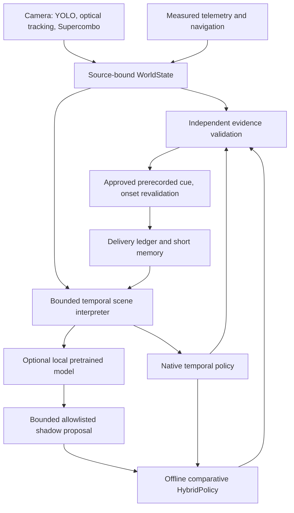

# Temporal pretrained intelligence V2

Candidate 0.6.0, 2026-10-27. Base `origin/master` at `aeb9fb8`.

The shipped Android decision path uses the native temporal policy. Model shadow
results are logged without calling `accept`, audio or navigation. This is a real
local inference pathway, but it has not been executed on the phone in this V2
run. A host comparison actually installs `HybridPolicy` for arm C, while A uses
the frozen previous Balanced DLL and B uses the new native temporal policy.
Urgent native decisions bypass the optional learned selector. No model output
can invent an urgent event or refresh an observation's original capture time.

`TemporalSceneInterpreter` extends existing namespaced identities rather than
starting another image tracker. It retains at most64 episodes and produces
explicit encounter phases, route windows, measured speed trends and delivery
history. Current actionable actors rank ahead of old lost tracks in the small
model summary. The core remains usable offline without pretrained weights.

`intelligence_model.py` owns a publisher llama.cpp server bound to127.0.0.1.
Android uses separate JNI llama.cpp libraries, a single background executor and
two CPU threads. Model loading never runs under the NativeCore monitor. One
inference is in flight, with no FIFO of old summaries. Source, settings revision,
scene generation, context freshness, thermal status and deadlines gate results.
Weights live in app-private storage after a hash-verified SAF import.

The approved candidate vocabulary supplies all wording and authority. In compact
mode the neural model generates a constrained letter, then trusted code binds it
to SILENCE, DEFER or an approved candidate. This is real neural selection; its
reason labels and metadata are deterministic bindings, not model explanations.
The full JSON research path is also retained and separately validates semantics.
Self-reported confidence is never calibrated driving evidence.

Existing Google/offline navigation, dashboard, destination search, voice toggle,
detector and Supercombo are preserved. Google provider content is excluded from
learned evaluation, including route-derived history after switching providers.
This does not disable normal native navigation coaching.

No inference of selected gear, pedals, clutch, intent, metric trajectory or safe
driving is added. A historical reduction in measured speed is only an observation.
No instructor-qualified quality improvement or release readiness is claimed.
